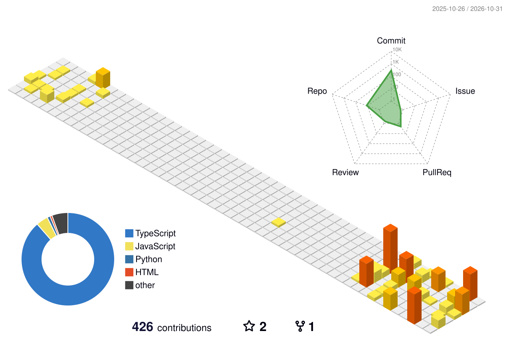

**Desenvolvedor Full-Stack** · Estagiário na DTI Sistemas · Engenharia de Software na PUC Minas

Desenvolvo e mantenho software para cliente externo com **.NET, C#, React e SQL**, incluindo adaptações à reforma tributária e a migração de um sistema legado.
Na pesquisa, sou responsável pelo back-end em **Python** do PanViTa 2, ferramenta de bioinformática de um projeto da UFMG.
No TCC, construo um sistema web e mobile de gestão operacional para empresas de móveis planejados.

## Projetos em destaque

| Projeto | O que é | Stack |
| --- | --- | --- |
| [PanViTa 2](https://github.com/VictorCaricatte/PanViTa-2) | Back-end de ferramenta de bioinformática que compara genomas bacterianos com bancos de resistência antimicrobiana e virulência | Python, pandas, NumPy, scikit-learn |
| [MontaControl (TCC)](https://github.com/ViniiSalles/MontaControl) | Gestão de ponto, atestados e avarias: web para gerência e RH, app mobile para montadores em campo | React + Vite, React Native + Expo, NestJS, PostgreSQL, WebSocket |
| [Chronos](https://github.com/ViniiSalles/Chronos) | Gestão ágil de projetos e tarefas com Kanban, reuniões e notificações; fiz telas, autenticação e back-end | Flutter, NestJS, MongoDB, Kafka, Firebase |
| [SCGR](https://github.com/ViniiSalles/SCGR) | Controle de gastos residenciais com saldo, receitas e despesas por pessoa | Next.js, TypeScript, Prisma, PostgreSQL |

**Em planejamento:** [Concordi](https://github.com/ViniiSalles/Concordi), uma ideia de plataforma open source de comunicação em tempo real (texto, voz e vídeo). O desenvolvimento ainda não começou.

## Tecnologias

  

  Também: React Native + Expo · APIs REST · WebSocket · SQL · pandas · NumPy · Red Hat RHCSA · Scrum · Spec-Driven Development

## Contribuições

<picture>
  <source media="(prefers-color-scheme: dark)" srcset="profile-3d-contrib/profile-night-rainbow.svg" />
  <source media="(prefers-color-scheme: light)" srcset="profile-3d-contrib/profile-green-animate.svg" />
  
</picture>

## Contato

  
  

